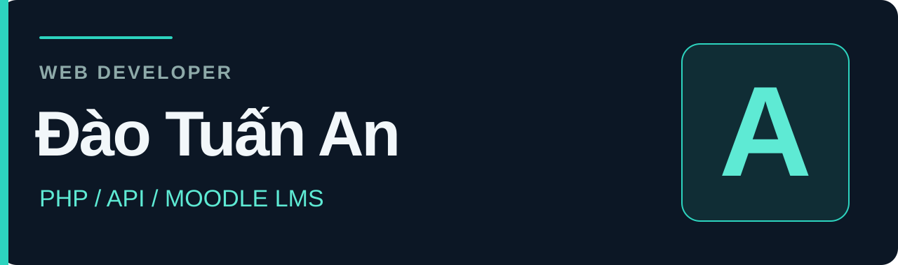

  

<h3 align="center">Phát triển tính năng. Kết nối hệ thống. Giải quyết lỗi.</h3>

  Lập trình viên web tại Việt Nam với <strong>2 năm kinh nghiệm</strong>. 
  Nhận freelance theo đầu việc và dự án, ưu tiên trao đổi bằng tiếng Việt.

  
  

  <strong>Remote · 18:00–23:00 hằng ngày · Giờ Việt Nam (UTC+7)</strong>

---

## Tôi có thể hỗ trợ

Bạn có website cần phát triển tiếp, API cần kết nối hoặc một lỗi đang cản trở công việc? Tôi nhận các đầu việc có phạm vi rõ ràng, trao đổi dự toán trước khi bắt đầu.

| Nhu cầu của bạn | Phần việc tôi nhận |
| :--- | :--- |
| **Phát triển backend** | Thêm tính năng, xử lý dữ liệu và bảo trì ứng dụng PHP, Laravel, Yii2, MySQL. |
| **Kết nối dịch vụ** | Tích hợp REST API, webhook và đồng bộ dữ liệu giữa các hệ thống. |
| **Tùy chỉnh Moodle** | Phát triển chức năng, plugin và giao diện cho hệ thống LMS theo yêu cầu. |
| **Sửa lỗi & giao diện** | Tìm nguyên nhân lỗi, chỉnh sửa luồng hiện có; làm việc với HTML, CSS, JavaScript, Vue. |

## Kinh nghiệm dự án

### LMS Moodle · Trường Đại học Gia Định

> Tham gia phát triển và tùy chỉnh hệ thống quản lý học tập (LMS) trên nền tảng Moodle cho Trường Đại học Gia Định.

**Nền tảng:** Moodle · PHP  
**Lĩnh vực:** Công nghệ giáo dục · Hệ thống quản lý học tập

[Xem hệ thống LMS của Trường Đại học Gia Định ↗](https://smart-lms-dev.giadinh.edu.vn/admin/search.php#linkmodules)

## Công nghệ sử dụng

  
  
  
  
  
  
  
  

Tôi dùng AI hỗ trợ đọc code, phát triển và kiểm thử; tôi chịu trách nhiệm kiểm tra phần việc mình bàn giao. Với công nghệ hoặc nghiệp vụ mới, tôi đánh giá khả năng đáp ứng sau khi xem yêu cầu và mã nguồn.

## Dự án công khai

### [Website nhà hàng · Vue 3 ↗](https://github.com/keiii2004/my-project-cuoiki)

Dự án học tập với các màn hình món ăn, chi tiết sản phẩm, giỏ hàng, thanh toán và lịch sử mua hàng. Giao diện và luồng mua hàng mẫu sử dụng dữ liệu mô phỏng.

**Vue 3 · Vue Router · Axios · JSON Server**  
[Xem cấu trúc màn hình và routing](https://github.com/keiii2004/my-project-cuoiki/blob/main/src/router/index.js)

### [CV cá nhân · HTML ↗](https://github.com/keiii2004/CV_DaoTuanAn)

Repository trang CV cá nhân, thể hiện cách tổ chức nội dung và giao diện bằng HTML.

## Cách làm việc

**01 · Làm rõ yêu cầu**  
Thống nhất đầu việc, phạm vi, quyền truy cập cần thiết và kết quả cần bàn giao.

**02 · Dự toán trước khi bắt đầu**  
Trao đổi chi phí và mốc hoàn thành dựa trên yêu cầu, công nghệ và mã nguồn thực tế.

**03 · Cập nhật & kiểm tra**  
Thực hiện theo đầu việc, cập nhật tiến độ và kiểm tra các luồng bị ảnh hưởng.

**04 · Bàn giao rõ ràng**  
Bàn giao thay đổi, cách kiểm tra và các lưu ý vận hành liên quan.

## Liên hệ

**Bạn đang cần hỗ trợ phần nào của dự án?** Gửi mô tả ngắn, công nghệ đang dùng và thời hạn mong muốn. Tôi sẽ trao đổi về phạm vi và báo giá phù hợp.

**[daotuanan2004@gmail.com](mailto:daotuanan2004@gmail.com)**  
Lịch làm việc: **18:00–23:00 hằng ngày, UTC+7** · Ưu tiên tiếng Việt.

<strong>English introduction</strong>

I'm An, a Vietnam-based web developer with 2 years of experience, available for scoped freelance tasks. My focus is PHP backend development, API integrations, Moodle customization and web maintenance. I have contributed to a Moodle-based LMS for Gia Dinh University. I use AI-assisted development and review my deliverables. Available daily, 18:00–23:00 UTC+7. Vietnamese communication preferred.

